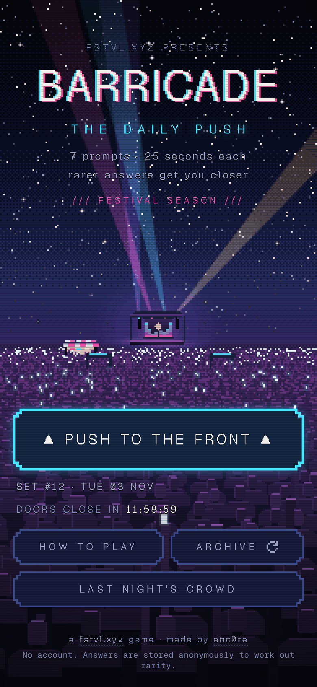
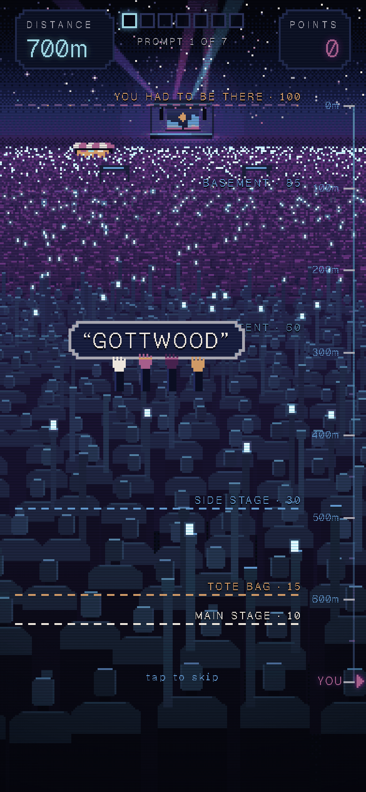
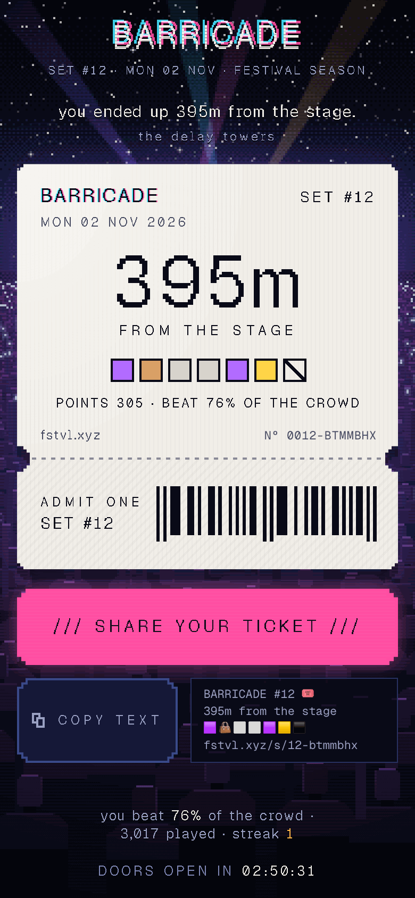

# BARRICADE

**The daily push to the front.** A daily rarity game about live music and the
culture around it. You get 5 prompts with 25 seconds each, and you type one
answer per prompt. The rarer your answer, the further the crowd carries you
toward the stage.

Play at **[fstvl.xyz](https://fstvl.xyz)** · made by [enc0re](https://enc0re.com)

<p align="center">
  
  
  
</p>

## How it plays

You start at the back of the field, **500m** from the stage. Each prompt
("Name a nightclub in Berlin", "Name a sound system crew at Notting Hill
Carnival", "Name a city on the Eras Tour") has a closed list of accepted
answers. Answers include artists, festivals, venues, cities, genres,
sound-system crews and stages. Questions focus on going to shows: lineups, tours, venues,
festivals and the scenes around them. Studio software and equipment trivia
are outside the game's scope. Every accepted answer has a rarity tier:

| Tier | Points | |
|---|---|---|
| MAIN STAGE | 10 | Everyone said it. |
| TOTE BAG | 15 | The "obscure" pick that everyone who thinks they're obscure picks. |
| SIDE STAGE | 30 | Real fans know it. |
| THE TENT | 60 | Rare. |
| BASEMENT | 85 | Very rare. Sweaty room, great sound system. |
| YOU HAD TO BE THERE | 100 | Almost nobody says this. |

Points are metres. Five perfect answers put you **on the barricade**. Wrong
guesses cost nothing but time, so you can keep trying until the clock runs out.
When you finish you get a ticket stub to share, and the next morning you can
see what the crowd said.

## How it works

```
OFFLINE                                              RUNTIME (Next.js)
content/source/*.json ─ validate ─┐                  /api/set     set info for your local date
Wikipedia pageviews ── fame ──────┼─ compile ──┐     /api/round   one prompt + a signed, server-timed token
                                  │            ▼     /api/answer  fuzzy match → tier + signed receipt
                                  │   pack.json ─ seal (AES-GCM) ─→ loader (unseals once, caches)
                                  │                  /api/finish  verify receipts → reveal + crowd stats
                                  └──────────────────/api/crowd   the Morning After
```

- **Answers never reach the browser before you finish.** Prompts are handed
  out one at a time, and the server owns the clock: each round's start time
  is in an HMAC-signed token. Scores are rebuilt from signed receipts, never
  taken from the client.
- **Rarity is fixed before the day starts**, the way Krillion does it. Each
  answer's share of players is estimated by blending **Wikipedia pageview
  fame** with an editor's tier guess, then mapped to a tier. Editorial flags
  (TOTE BAG, YOU HAD TO BE THERE) override the model. The real crowd numbers
  come back afterwards and feed the next rebuild.
- **Forgiving matching.** Accents, punctuation, "the", "&"/"and", number
  words and `A$AP`-style spellings are normalised. A typo budget scales with
  name length, and short names must be exact. An answer that is real but
  wrong for this prompt gets "real, but not here" instead of a flat no.
- **Spoiler-free public repo.** Real puzzles are committed only as sealed
  AES-256-GCM files in `content/sealed/`. The public sample pack in
  `content/sample/` "floats" across dates, so `pnpm dev` always has a set to
  play.
- **Crowd stats and answer reports** use Upstash Redis (Vercel Marketplace): one pipelined write
  per finished set. Without Redis, dev keeps stats in memory and production
  hides crowd numbers and marks answer reports unavailable.

Docs: [architecture](docs/ARCHITECTURE.md) · [design](docs/DESIGN.md) · [writing content](docs/CONTENT.md)

## Run it

```bash
pnpm install
pnpm dev                 # plays the public sample set
pnpm test                # vitest
pnpm typecheck
open "http://localhost:3000/?mock=1"   # UI-only mock mode (dev)
```

Environment variables (see `.env.example`):

| var | |
|---|---|
| `BARRICADE_SECRET` | HMAC key for round tokens and receipts (required in production) |
| `BARRICADE_SEAL_KEY` | 32-byte base64 key that unseals `content/sealed/*` (`pnpm content:keygen`) |
| `BARRICADE_EPOCH` | date of set #1, used when compiling content |
| `KV_REST_API_URL` / `KV_REST_API_TOKEN` | Upstash Redis for crowd stats and answer reports (optional) |
| `NEXT_PUBLIC_SITE_URL` | canonical URL for share links and OG tags |

## Writing content

```bash
pnpm content:check     # validate sources + schedule
pnpm content:fame      # fetch Wikipedia pageviews (cached)
pnpm content:build     # compile → content/build/pack.json
pnpm content:report    # tier distribution per prompt
pnpm content:seal      # encrypt pack + sources into content/sealed/
```

See [docs/CONTENT.md](docs/CONTENT.md) for the prompt format and the rules
that make a good prompt: bounded but deep, unambiguous, about live music and
its culture.

## Stack

Next.js 16 (App Router) · React 19 · TypeScript · Vitest · no UI framework.
The scene is a procedural pixel-art canvas, rendered at low resolution and
scaled up. Type is **[Geist Pixel](https://vercel.com/font)** with Geist Mono
(Vercel × basement.studio, SIL OFL 1.1; see `assets/fonts/OFL.txt`).
Inspired by [Krillion](https://krillion.io).

## License

Code: MIT. Fonts: SIL Open Font License 1.1. Puzzle content: © enc0re, all
rights reserved.
